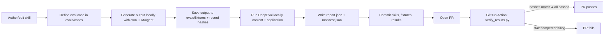

# Design: Frontend agent-skills store with DeepEval evals and a CI gate

## Problem statement

Create a lightweight, version-controlled repository that stores agent skills
focused on frontend engineering and testing (GOV.UK Design System–flavoured),
evaluates them along two separate concerns (skill-content quality and
skill-application quality), and gates PRs via a GitHub Action. Because CI has no
agent/LLM access, developers generate outputs and run the DeepEval suite
locally, commit the results plus fixtures, and CI adjudicates the committed
results with an integrity/freshness check.

## Background / research findings

### Agent Skills specification

Source: <https://agentskills.io> and <https://github.com/agentskills/agentskills>.

- A skill is a directory containing, at minimum, a `SKILL.md` file, plus optional
  `scripts/`, `references/`, and `assets/` directories.
- `SKILL.md` is YAML frontmatter followed by a Markdown body.
- **Required frontmatter:** `name`, `description`.
- **Optional frontmatter:** `license`, `compatibility`, `metadata`,
  `allowed-tools` (experimental).
- `name` constraints: 1–64 chars; lowercase alphanumeric (`a-z`, `0-9`) and
  hyphens only; must not start/end with a hyphen; no consecutive hyphens; **must
  match the parent directory name**.
- `description` constraints: 1–1024 chars; should describe what the skill does
  and when to use it, including keywords that help agents match tasks.
- Recommended: keep `SKILL.md` under ~500 lines and use **progressive
  disclosure** — metadata (~100 tokens) at startup, instructions (<5000 tokens)
  on activation, `references/`/`scripts/`/`assets/` on demand.
- A `skills-ref validate ./my-skill` reference validator exists for
  frontmatter/naming validation.

### DeepEval

Source: <https://deepeval.com>.

- Integrates with pytest via `assert_test()` and the `deepeval test run` command.
- Supports LLM-judge metrics (e.g., **G-Eval**) and deterministic metrics.
- Runs identically locally and in CI (failing metrics fail the build).
- The native report does **not** include source-content hashes of the skills,
  cases, or generated outputs — this is why a separate integrity **manifest**
  sidecar is required to bind results to the content they were produced from.

## Proposed directory layout

```
frontend-skills/
├── README.md
├── skills/
│   └── govuk-accessible-component/
│       ├── SKILL.md
│       ├── references/
│       └── assets/
├── evals/
│   ├── content/            # concern A
│   │   └── test_skill_content.py
│   ├── application/        # concern B
│   │   └── test_skill_application.py
│   ├── cases/              # task definitions
│   │   └── govuk-accessible-component/<case-id>.yaml
│   ├── fixtures/           # committed locally-generated outputs
│   │   └── govuk-accessible-component/<case-id>/output.*
│   ├── results/
│   │   ├── report.json     # DeepEval native report
│   │   └── manifest.json   # freshness/integrity hashes
│   ├── lib/                # shared helpers (load skills/cases, hashing, manifest write/verify)
│   ├── conftest.py
│   └── requirements.txt (or pyproject)
├── scripts/
│   ├── generate.py         # record local agent output into fixtures + manifest (does NOT call an LLM)
│   └── verify_results.py   # CI-side: validate + freshness-check report/manifest
└── .github/workflows/evals.yml
```

## End-to-end workflow



## Decision rationale

### Why local-generate + CI-adjudicate

CI has no agent/LLM and no API keys. Rather than trying to reproduce generation
or grading in CI (which would need a model, keys, cost, and non-determinism), the
developer does the expensive, non-deterministic work locally with their own LLM
and commits the outcome. CI's job is reduced to a fast, deterministic,
key-free adjudication of committed artifacts. This is also fork-friendly: PRs
from forks pass the gate without needing secrets.

### Why a DeepEval native report + a sidecar manifest (Q8=A while enabling Q7=A)

The committed results artifact is DeepEval's **native** JSON report, kept as-is,
so we don't couple CI to a bespoke format and we keep the tool's own output for
humans. But the native report does not carry hashes of the source skills, cases,
or generated outputs, so it cannot by itself prove the results correspond to the
current committed content. To satisfy the freshness/integrity requirement (Q7=A)
without altering the native report, we store content hashes in a separate
`manifest.json` sidecar. CI recomputes the hashes from the current committed
content and compares them to the manifest, failing on any mismatch (stale or
tampered results). This cleanly separates "what DeepEval produced" from "what
content it was bound to".

### Why two explicitly separate concerns

Skill-content quality (are the docs valid/clear/complete?) and skill-application
quality (is the produced output good?) are different questions with different
failure modes and owners. Keeping them separate — distinct directories
(`evals/content/` vs `evals/application/`), distinct test files/metrics, and
separately labelled outcomes in `report.json` — lets a reader see each concern's
result independently and lets the CI gate report which concern failed.

## Integrity model details

`manifest.json` records, for the run that produced `report.json`:

- A content hash of each skill directory (or its `SKILL.md` + referenced files).
- A content hash of each task case (`evals/cases/<skill>/<case-id>.yaml`).
- A content hash of each generated fixture output
  (`evals/fixtures/<skill>/<case-id>/output.*`).
- Enough identity metadata (skill name, case id, concern) to map manifest entries
  back to report entries.

CI (`scripts/verify_results.py`) recomputes each hash from the current committed
tree and fails if any differ, if `report.json`/`manifest.json` are missing or
invalid, or if any recorded case failed.

## Non-goals

- Running an agent/LLM in CI.
- Committing API keys or requiring CI secrets.
- Frontend build tooling (deferred).
- More than one seed skill in this change.
